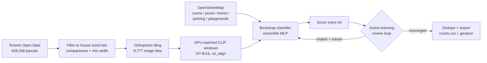

# toronto-hoops

Ever wonder how many Torontonians have a private basketball court in their backyard? Probably
not... But in case you did, there are at least **276 confirmed backyard basketball courts** across
the entire city.

  
   A sample of confirmed detections, each tile centred on the actual court.

  

This started as a project to learn how to train vision models on real-world aerial imagery, in an
attempt to track down the city's hidden home courts using public orthophoto feed and an open 
parcel-boundary dataset.

## Pipeline

1. **Parcel sourcing** — pull Toronto's open parcel data, filter down to house-sized residential lots
2. **Imagery + embeddings** — tile the city's aerial orthophoto feed, GPU-batch every lot through CLIP
3. **Bootstrap classifier\*** — train an MLP ensemble on OpenStreetMap courts/pools/tennis courts as weak labels
4. **Active learning** — score every lot, review the top candidates, relabel, retrain, repeat
5. **Dedupe + export** — merge same-court duplicates, ship CSV/GeoJSON with map links

*\* step 3 was originally just going to prompt CLIP directly (zero-shot) with no labeled data at all, but 
it ranked driveways and flat rooftops too highly. in order to actually refine the results to be correct I 
trained an actual classifier and ran it through active learning instead.*

## How it works

### 1. Parcel sourcing

- Takes in "parcels" which are legal property boundaries polygons. Since these parcels don't have a land-use code
  or building footprint, residential parcels are approximated.
- I decided to keep parcels with `FEATURE_TYPE == COMMON` that are between 150–1,500 m² because that's roughly the
  size range of a house lot. Oddly shaped parcels that are too narrow are also filtered out.
- While not perfect, this reduced raw parcel count from ~498,000 to **428,348** house-sized lots.
- **Note:** In the future, increasing the lot size range will probably give better accuracy.
- **Run it:** `python fetch_parcels.py`

### 2. Imagery + embeddings

- Orthophotos are provided the City of Toronto's public ArcGIS tile/export service, which gives aerial photos
  straight down with no perspective distortion.
- **Note:** I can't find a capture date, so unfortunately I don't know how up-to-date this search is.
- Separate images per lot would be too many downloads, so I sliced the city into 300m tiles that
  are downloaded once and reused for every lot inside it. 
- Then, a **CLIP (Contrastive Language–Image Pretraining)** neural network transforms the images to lists of
  numbers (embeddings) such that visually and semantically similar images end up with similar numbers.
- Usually, this is for automatically matching images to text captions, but I'm using it as a general
  "what does this look like" extractor.
- A grid of candidate ~14m windows is laid over each lot, and every window on a tile is
  cropped and embedded in a single GPU call using `torchvision`'s `roi_align` to pull crops
  directly out of the tile's image tensor on the GPU, rather than cropping and resizing each window
  one at a time in Python (tried this and it was way too slow).
- **Run it:** `python detect.py [--bbox LON_MIN LAT_MIN LON_MAX LAT_MAX] [--max-blocks N]`
  (resumable, embeddings get cached in `data/windows/`).

### 3. Bootstrap classifier

- OpenStreetMap already has a tagged, sparse, really weak set of public basketball courts (`sport=basketball`),
  tennis courts, and swimming pools. Although not "private backyard courts", I used it as a starting point, using
  pools and tennis courts as hard negatives, so while similar, won't false flag.
- The classifier itself is an **ensemble** of 5 small two-layer neural networks (512 → 256 → 1
  neurons) trained on top of the frozen CLIP embeddings. The CLIP teaches the smaller, faster model to read the
  embeddings. Takes the average of 5 independently-trained networks to smooth out errs one may have.
- **Run it:** `python train_probe.py [--holdout]` — the first run builds and caches the OpenStreetMap
  training set; every later run retrains on top of whatever's in `data/labels.csv` from the next
  step.

### 4. Active learning

- After first pass, I rendered the highest-scoring lots as a labeled grid of images, looked at each one,
  and marked the real courts. Confirmed courts get 4x **upweighted** during training and confirmed
  rejections 2x upweighted, so the model pays more attention to its own recent mistakes than to the
  bulk of easy negatives.
- **Note:** early rounds had a lot of false positives that *look* flat and open from directly overhead,
  but each retraining round pushed those down the ranking while pulling up genuinely hard true positives:
  courts half-hidden by trees, courts sharing a frame with a pool.
- A couple of cycles of retraining and rescoring the highest-scoring lots resulted in 287 confirmed courts, and
  1,237 confirmed non-courts.
- **Run it:**
  - `python review.py --unseen --band 0.9 1.01 --top 64` — a grid of the highest-scoring,
    not-yet-reviewed lots (`data/review.jpg`)
  - `python review.py --zoom 3,7,9` — a closer look at specific tiles from that grid
  - `python label.py --courts 1,2,5 --skip 8` — records which ranks were real courts
  - retrain with `train_probe.py`, pick a new `--band`, and repeat until a page comes back with
    nothing new

### 5. Dedupe + export

- Since a single court often sits right on the line between two lots and would count twice, results were
  **deduplication** by merging courts within 40 meters of each other.
- The final list ships as both **CSV** and **GeoJSON** (so mapping tools can open it directly), with
  every row having Google Maps satellite link for convenience.
- `montage_courts.py` renders the confirmed list back out as labeled image grids for a final visual sanity
  check, and `generate_report_assets.py` builds the charts used above.
- **Run it:** `python count.py --confirmed` (or `python count.py --threshold 0.9` to export straight
  from scores, skipping the manual review pass).

## Project structure

| File | Role |
|---|---|
| `common.py` | Shared paths, the orthophoto fetcher, and the GPU `Clip` embedding wrapper |
| `fetch_parcels.py` | Downloads and filters the parcel dataset |
| `detect.py` | Tiles imagery and embeds every lot's candidate windows |
| `train_probe.py` | Builds the OSM-bootstrapped training set and trains the classifier |
| `review.py` / `label.py` | The active-learning review loop |
| `count.py` | Scores, dedupes, and exports the final court list |
| `montage_courts.py` | Renders labeled image grids of the confirmed courts |
| `generate_report_assets.py` | Builds the charts in this README |
| `data/courts.csv`, `data/courts.geojson` | **The results** |
| `data/labels.csv` | Every window reviewed during active learning |
| `data/probe.npz` | The trained classifier |
| `data/osm_*.json`, `data/osm_backyard_courts.csv` | OpenStreetMap training examples |

`data/windows/`, `data/candidates.npz`, and the other large caches listed in `.gitignore` aren't
tracked in this repo (gigabytes of regenerable embeddings) — re-running `detect.py` rebuilds them.

## Data sources & license

- Imagery and parcel boundaries: **City of Toronto**, via its public ArcGIS and Open Data services
  (Open Government Licence – Toronto).
- Training examples for courts, pools, tennis courts, parking lots, and playgrounds: **OpenStreetMap
  contributors** (Open Database License).
- Code in this repository: [MIT License](LICENSE).
