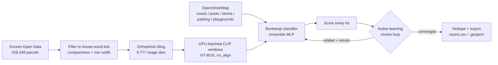

# toronto-hoops

Ever wonder how many Torontonians have a private basketball court in their backyard? Probably
not — but in case you did, there are at least **276 confirmed backyard basketball courts** across
the entire city.

  
   A sample of confirmed detections, each tile centred on the actual court.

  

This started as a project to learn how to train vision models on real-world aerial imagery, in an
attempt to track down the city's hidden home courts — with nothing to go on but a public orthophoto
feed and an open parcel-boundary dataset.

## Pipeline

1. **Parcel sourcing** — pull Toronto's open parcel data, filter down to house-sized residential lots.
2. **Imagery + embeddings** — tile the city's aerial orthophoto feed, GPU-batch every lot through CLIP.
3. **Bootstrap classifier** — train an MLP ensemble on OpenStreetMap courts/pools/tennis courts as weak labels.
4. **Active learning** — score every lot, review the top candidates, relabel, retrain, repeat.
5. **Dedupe + export** — merge same-court duplicates, ship CSV/GeoJSON with map links.

*Amendment: step 3 wasn't the starting point — it's what step 3 became. The very first pass skipped
training entirely and just prompted CLIP directly ("an aerial photo of a basketball court" vs. a
pool, a driveway, a lawn) — a pure zero-shot, vision-language approach with no labeled data at all.
It found real courts, but it also ranked sun-bleached driveways and flat rooftops above courts
sitting in tree shade. That gap is exactly what pushed this into training an actual classifier and
running it through active learning instead of trusting a frozen prompt.*

## How it works, step by step

Each section below explains the step in plain terms, calls out the parts that were genuinely hard
to get right, and gives the exact command that runs it.

### 1. Parcel sourcing

- There's no "basketball court" layer in any public Toronto dataset, so step one is just figuring
  out *where houses even are*. A **parcel** is simply a legal property boundary — a polygon on a
  map, nothing more.
- Toronto's open Property Boundaries dataset gives a parcel ID and a stated area, but no address, no
  land-use code, and no building footprint — it doesn't even say "this is a house" vs. "this is a
  school." So "residential" is approximated: keep ordinary parcels (`FEATURE_TYPE == COMMON`)
  between 150–1,500 m², roughly the size range of a detached house lot.
- Odd-shaped slivers (narrow lanes, leftover strips of land) get filtered out with two simple
  geometry checks: a **compactness** ratio (how much of the lot's own bounding rectangle it
  actually fills) and a minimum width, so the pipeline doesn't waste time scanning a 2-metre-wide
  strip of grass.
- That brings ~498,000 raw parcel polygons down to **428,348** house-sized lots.
- **Hard part:** nothing in the data says "residential" directly — every filter here is a guess
  backed only by lot size and shape, so a few non-houses inevitably slip through and a few real
  houses on odd-shaped lots get dropped.
- **Scope:** this only covers the City of Toronto proper. The city's imagery service doesn't extend
  into Mississauga, Brampton, Markham, or the rest of the GTA, so courts outside Toronto's own
  boundary simply aren't in this dataset.
- **Run it:** `python fetch_parcels.py`

### 2. Imagery + embeddings

- Keyword: **orthophoto** — an aerial photo that's been corrected to line up accurately with a map
  (straight down, no perspective distortion), unlike a regular angled photo. Toronto publishes one
  through a public ArcGIS tile/export service.
- Downloading a separate image per lot would mean 428,348 downloads. Instead, the city gets sliced
  into ~300-metre tiles (9,777 of them), each tile downloaded once and reused for every lot inside
  it.
- Keyword: **CLIP** (Contrastive Language–Image Pretraining) — a neural network that turns any image
  into a list of numbers (an **embedding**) such that visually and semantically similar images end
  up with similar numbers. It's normally used to match images to text captions; here it's
  repurposed as a general-purpose "what does this look like" feature extractor.
- A grid of candidate 128-pixel (~14 m) windows is laid over each lot, and every window on a tile is
  cropped and embedded **in a single GPU call** using `torchvision`'s `roi_align` — pulling crops
  directly out of the tile's image tensor on the GPU, rather than cropping and resizing each window
  one at a time in Python.
- **Hard part:** the first version did exactly that — a Python crop-and-resize per window — and it
  was far too slow to ever finish scanning the whole city. Batching every window on a tile into one
  GPU operation is what turned a full-city scan from a multi-day job into a multi-hour one.
- **Limitation:** the imagery service doesn't publish a capture date anywhere, so every result here
  reflects whenever that imagery happened to be flown, not necessarily today.
- **Run it:** `python detect.py [--bbox LON_MIN LAT_MIN LON_MAX LAT_MAX] [--max-blocks N]`
  (resumable; `--bbox` lets you try one neighbourhood first; embeddings get cached in
  `data/windows/`).

### 3. Bootstrap classifier

- Keyword: **weak labels** — labels that are easy to get automatically but aren't perfectly
  accurate, used to get a model started before any manual work happens.
- OpenStreetMap tags a sparse set of public basketball courts (`sport=basketball`), tennis courts,
  and swimming pools. None of that is really "private backyard courts," but it's a free, if noisy,
  starting point: courts become positive examples, while tennis courts and pools become **hard
  negatives** — the two things that look most like a court from directly above, and the most likely
  to be mistaken for one.
- The classifier itself is an **ensemble** of 5 small two-layer neural networks (512 → 256 → 1
  neurons) trained on top of the frozen CLIP embeddings — not fine-tuning CLIP itself, just teaching
  a much smaller, faster model to read CLIP's embeddings. Averaging 5 independently-trained networks
  smooths out the quirks any single one would have.
- **Hard part (the pivot):** as the amendment above mentions, the very first version of this project
  skipped training altogether and just asked CLIP directly whether an image looked like "a
  basketball court." That zero-shot approach is the reason this step exists at all — it wasn't
  accurate enough on its own, so a trained classifier replaced it.
- **Run it:** `python train_probe.py [--holdout]` — the first run builds and caches the OpenStreetMap
  training set; every later run retrains on top of whatever's in `data/labels.csv` from the next
  step.

### 4. Active learning

- Keyword: **active learning** — instead of labeling a huge dataset by hand up front and training
  once, the model scores everything first, a human only reviews the cases it's least sure about (or
  most likely wrong on), and the model gets retrained on those corrections. Repeat.
- In practice: render the highest-scoring (or a random sample from a chosen score range) lots as a
  labeled grid of images, look at each one, mark the real courts, retrain, and rescore the whole
  city. Then repeat with the model's new ranking.
- Confirmed courts get **upweighted** (4×) during training and confirmed rejections upweighted (2×),
  so the model pays more attention to its own recent mistakes than to the bulk of easy negatives.
- **Hard part:** early rounds were dominated by false positives that *look* flat and open from
  directly overhead — parking-lot line markings, sun-bleached driveway concrete, flat rooftops —
  exactly the kind of thing the original zero-shot prompt also struggled with. Each retraining round
  pushed those down the ranking while pulling up genuinely hard true positives: courts half-hidden
  by trees, courts sharing a frame with a pool.
- The hand-labeled set grew from a 53-example calibration pass to **1,524 reviewed window labels**
  (287 confirmed courts, 1,237 confirmed non-courts) by the final round, with each round's model
  checked against a held-out 20% slice of labels it hadn't trained on — **average precision stayed
  in the 0.95–0.98 range** throughout, so the ranking stayed trustworthy even as the labeled set kept
  growing and the model kept being re-fit from scratch.
- **Limitation:** this is also where the 276-court number comes from, and why it's a floor, not a
  ceiling. A hoop on a driveway, a portable hoop, or a court fully hidden under tree canopy is
  invisible from directly overhead no matter how good the classifier gets, and lots scoring below
  roughly 0.7 were only spot-checked rather than exhaustively reviewed.
- **Run it:**
  - `python review.py --unseen --band 0.9 1.01 --top 64` — a grid of the highest-scoring,
    not-yet-reviewed lots (`data/review.jpg`)
  - `python review.py --zoom 3,7,9` — a closer look at specific tiles from that grid
  - `python label.py --courts 1,2,5 --skip 8` — records which ranks were real courts
  - retrain with `train_probe.py`, pick a new `--band`, and repeat until a page comes back with
    nothing new

### 5. Dedupe + export

- A single physical court often sits right on the line between two lots, so the same court can show
  up twice — once from each neighbour's window grid.
- Keyword: **deduplication** — any detection within 40 metres of a higher-scoring one gets merged,
  keeping only the best-scoring lot per physical court.
- The final list ships as both **CSV** and **GeoJSON** (a standard geographic data format most
  mapping tools can open directly), with every row carrying a ready-to-click Google Maps satellite
  link.
- Two small finishing scripts round this out: `montage_courts.py` renders the confirmed list back
  out as labeled image grids for a final visual sanity check, and `generate_report_assets.py` builds
  the charts used above.
- **Run it:** `python count.py --confirmed` (or `python count.py --threshold 0.9` to export straight
  from scores, skipping the manual review pass).

## Project structure

| File | Role |
|---|---|
| `common.py` | Shared paths, the orthophoto fetcher, and the GPU `Clip` embedding wrapper |
| `fetch_parcels.py` | Downloads and filters the parcel dataset |
| `detect.py` | Tiles imagery and embeds every lot's candidate windows |
| `train_probe.py` | Builds the OSM-bootstrapped training set and trains the classifier |
| `review.py` / `label.py` | The active-learning review loop |
| `count.py` | Scores, dedupes, and exports the final court list |
| `montage_courts.py` | Renders labeled image grids of the confirmed courts |
| `generate_report_assets.py` | Builds the charts in this README |
| `data/courts.csv`, `data/courts.geojson` | **The results** |
| `data/labels.csv` | Every window reviewed during active learning |
| `data/probe.npz` | The trained classifier |
| `data/osm_*.json`, `data/osm_backyard_courts.csv` | OpenStreetMap training examples |

`data/windows/`, `data/candidates.npz`, and the other large caches listed in `.gitignore` aren't
tracked in this repo (gigabytes of regenerable embeddings) — re-running `detect.py` rebuilds them.

## Data sources & license

- Imagery and parcel boundaries: **City of Toronto**, via its public ArcGIS and Open Data services
  (Open Government Licence – Toronto).
- Training examples for courts, pools, tennis courts, parking lots, and playgrounds: **OpenStreetMap
  contributors** (Open Database License).
- Code in this repository: [MIT License](LICENSE).
