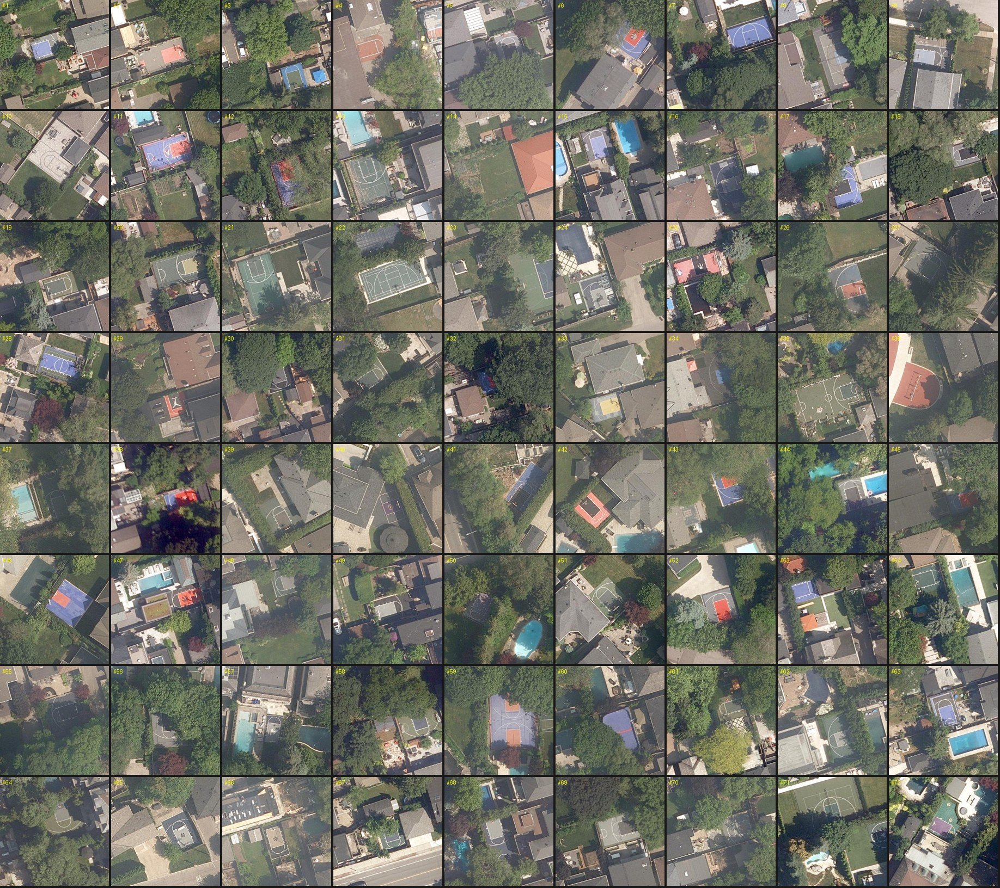
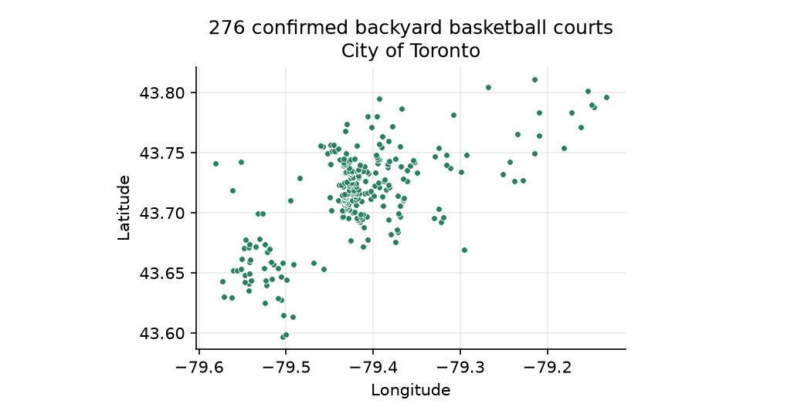
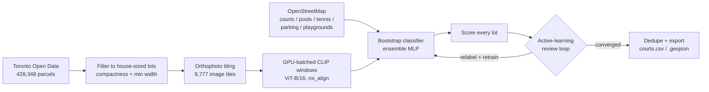
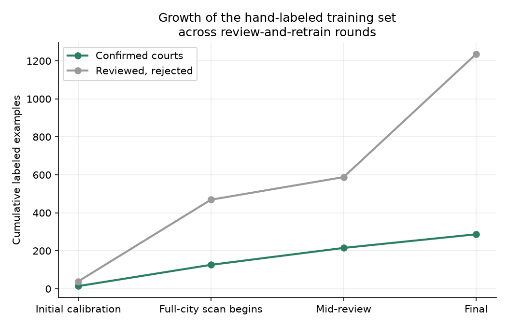

# toronto-hoops

Finding every backyard basketball court in a major city from aerial imagery alone — no building
footprints, no address data, nothing but a public orthophoto feed, open parcel boundaries, and a
vision-language model pushed into a role it wasn't built for.

The pipeline scans the City of Toronto's full residential parcel inventory, turns each lot into a
small set of GPU-batched CLIP embeddings, and scores them with a classifier that started from
nothing but OpenStreetMap tags and was refined over successive rounds of active learning into a
model that reliably tells a basketball court apart from a pool, a tennis court, a parking lot, or
a sun-faded patch of driveway.

**Result: 276 confirmed backyard basketball courts found and verified across the entire city.**

<p align="center">
  
  <br><sub>A sample of confirmed detections, each tile centred on the actual court.</sub>
</p>

<p align="center">
  
</p>

## Why this is a harder problem than it sounds

There is no "basketball court" layer in any public dataset for Toronto. The only ingredients
available are:
- an **ArcGIS tile/export service** serving the city's orthophoto imagery (~11 cm/pixel on the
  ground), with no capture date and no object metadata at all;
- a **parcel-boundary dataset** with a parcel ID and a stated area, nothing else — no address, no
  land-use code, no building footprint;
- **OpenStreetMap**, which has a sparse, noisy `sport=basketball` tag, mostly on public courts, and
  essentially never on the private backyard courts this project cares about.

So every signal — what counts as a house lot, where on that lot to look, and what a court actually
looks like from directly overhead — had to be built from scratch rather than looked up.

## Approach



### 1. Parcel sourcing and filtering
Toronto's Property Boundaries open dataset has no land-use field, so "residential" is approximated
by keeping ordinary (`FEATURE_TYPE == COMMON`) parcels between 150–1,500 m², then dropping slivers
and oddly-shaped lots with a compactness check (`area / minimum-rotated-rectangle area ≥ 0.6`) and a
minimum-width check (`≥ 7 m`). That brings 498k raw parcel polygons down to **428,348** house-sized
lots across the city.

### 2. Imagery pipeline
Rather than downloading and storing full-resolution imagery per lot, the pipeline tiles the city
into 300 m blocks (9,777 of them), downloads each once from the city's export endpoint, and reuses
it for every lot inside that tile. A grid of candidate window centres (128 px / ~14 m square, on an
~8.6 m stride) is laid over each lot's polygon, and every window is extracted and embedded **on the
GPU in a single batched call per tile** using `torchvision.ops.roi_align` directly against the
tile's tensor — avoiding a Python-level crop-and-resize per window, which is what made scanning
hundreds of thousands of lots computationally tractable on a single consumer GPU.

### 3. From zero-shot prompts to a trained classifier
The first pass used plain CLIP zero-shot scoring against text prompts ("an aerial photo of a
basketball court" vs. pools, patios, driveways, lawns). It worked well enough to *find* a handful of
real courts, but precision near the top of the ranking was poor — courts under tree cover scored
far lower than driveways, flat roofs, and sun-bleached concrete. That motivated moving to a trained
classifier: a small MLP ensemble (5 independently-seeded two-layer networks, 512 → 256 → 1,
class-balanced and sample-weighted) on top of frozen CLIP embeddings, with scores averaged across
the ensemble.

### 4. Bootstrapping with OpenStreetMap, before any manual labels existed
Before a single image had been hand-reviewed, the classifier already had a sense of what a court
looked like and what it didn't:
- **Positives** — OpenStreetMap's `sport=basketball` points and ways, plus the small subset of
  those that happen to sit inside a residential parcel (upweighted, since those are the closest
  analog to the private courts being searched for).
- **Hard negatives** — OpenStreetMap tennis courts and swimming pools (the two most visually similar
  features from directly above), parking lots, playgrounds, and large flat-roofed buildings, plus
  thousands of random windows sampled from ordinary residential lots.

### 5. Active learning: review, label, retrain, repeat
With a classifier in hand, every lot in the city was scored, and the review loop began:
- a grid of the highest-scoring (or a random sample within a chosen score band) candidates was
  rendered as a labeled image grid;
- each tile was judged — a true court, a lookalike (pool, roof, pad, shadow), or left unlabeled when
  genuinely ambiguous;
- the labels were folded back into training (confirmed courts upweighted 4×, confirmed rejections
  2×) and the ensemble was retrained;
- every lot was rescored and the next round of review started from whatever the new model ranked
  highest among lots it hadn't already seen.

This is the part that actually drove the result: the first rounds were dominated by false positives
(flat rooftops, parking-lot markings, sun-faded driveway concrete), and each retraining pass pushed
those out of the top of the ranking while pulling genuinely hard cases — courts partly hidden by
trees, courts sharing a frame with a pool — further up. The hand-labeled set grew from a 53-example
calibration pass to **1,524 reviewed window labels** (287 confirmed courts, 1,237 confirmed
non-courts) by the final round, and each round's classifier was checked against a held-out 20% of
the labeled set it hadn't trained on.

<p align="center">
  
</p>

Held-out average precision on labeled windows stayed in the **0.95–0.98** range through every
retraining round once the ensemble and hard-negative mining were in place — meaning the ranking
stayed trustworthy even as the labeled set kept growing and the model kept being re-fit from
scratch each round.

### 6. Deduplication and export
A single physical court often spans two neighbouring lots (each sees a different slice of it), so
detections within 40 m of a higher-scoring one are merged, keeping only the best-scoring lot per
court. The final list is exported as both CSV and GeoJSON, with a ready-to-click Google Maps
satellite link for every court.

## Reproducing it

```
python -m venv .venv
.venv\Scripts\pip install torch torchvision --index-url https://download.pytorch.org/whl/cu124
.venv\Scripts\pip install -r requirements.txt
```

1. **`python fetch_parcels.py`** — downloads Toronto's property-boundary dataset and filters it down
   to house-sized lots.
2. **`python detect.py [--bbox LON_MIN LAT_MIN LON_MAX LAT_MAX] [--max-blocks N]`** — tiles the
   imagery, embeds every lot's candidate windows on the GPU, and caches them in `data/windows/`.
   Fully resumable; a `--bbox` lets you try it on one neighbourhood first.
3. **`python train_probe.py [--holdout]`** — builds the OpenStreetMap-bootstrapped training set (cached
   after the first run) and trains the MLP ensemble, folding in anything in `data/labels.csv`.
4. **Review loop:**
   - `python review.py --unseen --band 0.9 1.01 --top 64` — a labeled image grid of the
     highest-scoring, not-yet-reviewed lots (`data/review.jpg`).
   - `python review.py --zoom 3,7,9` — a closer look at specific tiles from the last grid.
   - `python label.py --courts 1,2,5 --skip 8` — records which ranks were real courts (anything not
     listed becomes a confirmed negative, unless `--skip`ped as ambiguous).
   - Retrain (`train_probe.py`) and repeat with a new `--band` until a page comes back with nothing
     new.
5. **`python count.py --confirmed`** — writes the final `data/courts.csv` / `data/courts.geojson`
   from everything confirmed during review (or `python count.py --threshold 0.9` to export directly
   from scores, without the manual pass).
6. **`python montage_courts.py`** — renders the full confirmed list as labeled image grids in
   `data/court_grids/`, for a final visual sanity pass.
7. **`python generate_report_assets.py`** — regenerates the two charts used above.

## Project structure

| File | Role |
|---|---|
| `common.py` | Shared paths, the orthophoto fetcher, and the GPU `Clip` embedding wrapper |
| `fetch_parcels.py` | Downloads and filters the parcel dataset |
| `detect.py` | Tiles imagery and embeds every lot's candidate windows |
| `train_probe.py` | Builds the OSM-bootstrapped training set and trains the classifier |
| `review.py` / `label.py` | The active-learning review loop |
| `count.py` | Scores, dedupes, and exports the final court list |
| `montage_courts.py` | Renders labeled image grids of the confirmed courts |
| `generate_report_assets.py` | Builds the charts in this README |
| `data/courts.csv`, `data/courts.geojson` | **The results** |
| `data/labels.csv` | Every window reviewed during active learning |
| `data/probe.npz` | The trained classifier |
| `data/osm_*.json`, `data/osm_backyard_courts.csv` | OpenStreetMap training examples |

`data/windows/`, `data/candidates.npz`, and the other large caches listed in `.gitignore` aren't
tracked in this repo (gigabytes of regenerable embeddings) — re-running `detect.py` rebuilds them.

## Limitations

- **Visible courts only.** A hoop on a driveway, a portable hoop, or a court fully hidden by tree
  canopy is invisible from directly overhead, so the true count is higher than 276.
  Courts scoring below roughly 0.7 were only spot-checked, not exhaustively reviewed.
- **Imagery date is unpublished.** The orthophoto service doesn't expose a capture year, so this is
  a snapshot of whenever that imagery was flown, not necessarily today.
- **Scope.** Coverage is the City of Toronto only — the orthophoto service's extent doesn't reach
  Mississauga, Brampton, Markham, or the rest of the wider GTA.

## Data sources & license

- Imagery and parcel boundaries: **City of Toronto**, via its public ArcGIS and Open Data services
  (Open Government Licence – Toronto).
- Training examples for courts, pools, tennis courts, parking lots, and playgrounds: **OpenStreetMap
  contributors** (Open Database License).
- Code in this repository: [MIT License](LICENSE).
